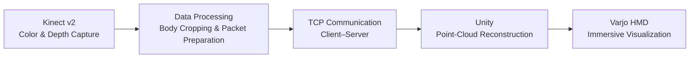

# Immersive Remote Collaboration in Mixed Reality

An end-to-end mixed-reality telepresence system developed as my Master's thesis at Chemnitz University of Technology.

## Overview

How can remote collaborators share a sense of physical space beyond conventional video conferencing?

This project explores an immersive remote collaboration system that captures live RGB-D data using a Microsoft Kinect v2, transmits the data over a local network, and reconstructs a 3D point-cloud representation in Unity for viewing through a Varjo mixed-reality headset.

I independently implemented the software system, working across sensor data acquisition, data processing, network communication, and real-time visualization. The project also integrates audio communication and supports interactive repositioning of the remote participant's representation.

## System Architecture

The system uses a bidirectional communication architecture: each participant's setup captures and transmits outgoing sensor data while receiving and visualizing the remote participant's representation.

## Engineering Challenges

### RGB-D Data Processing

Captured color and depth data are processed to support point-cloud reconstruction. Body-region cropping helps reduce the amount of data transmitted over the network.

### Network Communication

I evaluated UDP and TCP for RGB-D data transmission. Practical experiments with large data packets revealed reliability issues with UDP, which could result in incomplete data and corrupted reconstructions. I therefore selected TCP to provide reliable, ordered delivery.

### Real-Time System Integration

The project integrates Kinect-based acquisition, network communication, Unity-based visualization, and a Varjo headset into a working telepresence pipeline. Network reception is handled using a Unity coroutine to avoid blocking the rendering process.

### System Configuration and Reliability

The implementation includes configurable network settings and reconnection handling to support communication between the two setups.

## Evaluation

I conducted a qualitative user study with six participants to investigate spatial presence, social presence, and the experience of remote collaboration compared with conventional video conferencing.

The results indicated a strong sense of spatial presence, while social presence and the perception of body language did not consistently outperform conventional video conferencing.

The project also revealed limitations associated with single-camera reconstruction, visual fidelity, and latency, providing directions for future improvements.

## Technology Stack

- **Programming language:** C#
- **Engine:** Unity
- **Depth camera:** Microsoft Kinect v2
- **Visualization:** 3D point clouds
- **Networking:** TCP client–server communication
- **Display:** Varjo mixed-reality headset

## Key Takeaways

- Independently implemented an end-to-end software system spanning hardware integration, data processing, networking, and visualization.
- Investigated practical network reliability issues and made implementation decisions based on experimental observations.
- Integrated multiple hardware and software components into a real-time mixed-reality application.

## Project Information

- **Project type:** Master's thesis
- **Institution:** Chemnitz University of Technology
- **Completion date:** June 2026
- **Source code:** Not publicly available at this stage.
- **Demo:** No publicly accessible runnable demo is currently available.

This repository documents the project architecture, implementation, and findings. It does not contain the complete source code or a runnable application.
